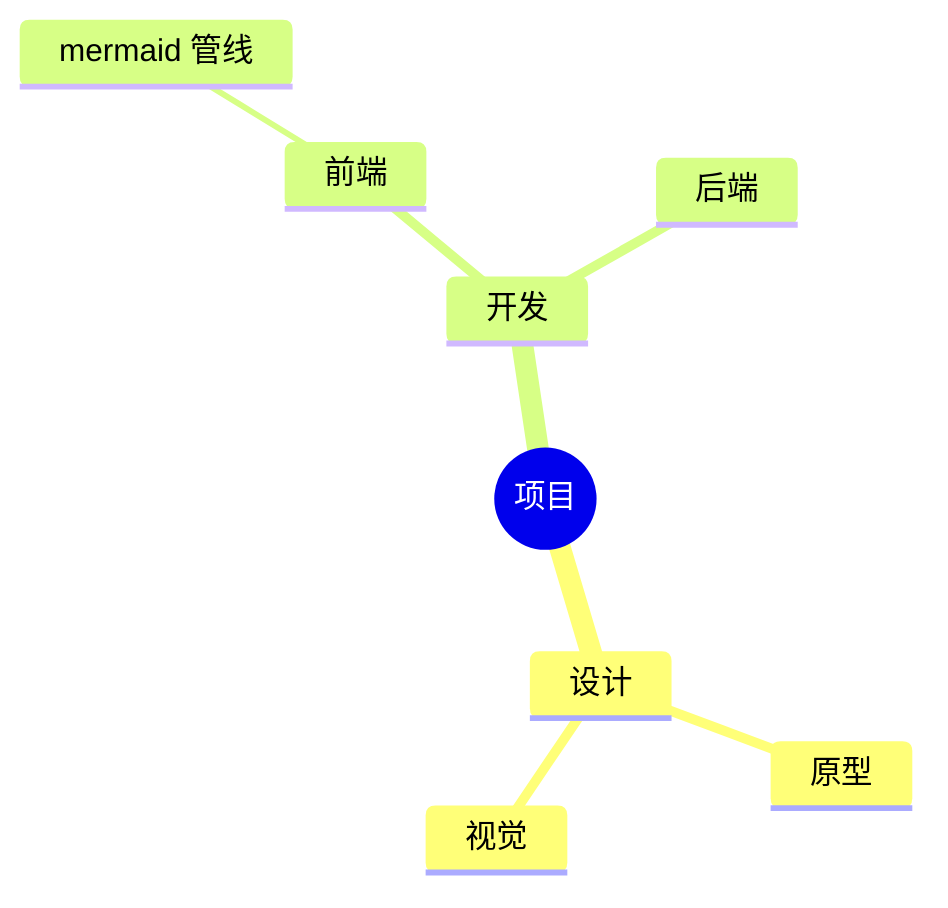
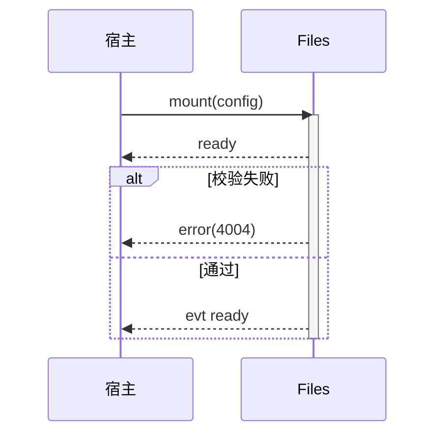

# mmagix-files 图示类应用设计（脑图 · 时序图 · 架构图）

> **【实现状态 · 2026-10-26 审计】** **本文为规划文档——脑图/时序图/架构图编辑器均未实现**（注册表无此三应用；当前仅 mermaid-viewer 只读覆盖 + 非 graph TD 语法降级只读渲染）。§3.3 提议的「view+code-editor 双注册」形态实际已由既有 mermaid-viewer + code-editor 覆盖，专设 sequence-viewer 无落地必要。

## 〇、头表

| 项 | 值 |
| --- | --- |
| 版本 | V1.0（2026-10-13 首版） |
| 状态 | **草案（候裁）** |
| 依据 | 《flow-editor-design.md》V1.0（姊妹篇——存储/渲染/回写/隔离全部沿用其架构与三条纪律条款）；《style-isolation.md》V1.0 |
| 范围 | 脑图（mindmap）/ 时序图（sequenceDiagram）/ 架构图（architecture-beta）三类应用的源格式、渲染、编辑形态与集成口径 |
| 定位 | 三个新增注册表应用，走既有 AppRegistry /「打开方式」体系；与流程图共享同一套「mermaid 文本源 + 多端渲染」管线 |

---

## 一、总体结论（先读这节）

| 图 | 源格式 | 兜底渲染 | 编辑形态 | 编辑引擎 | 一句话定位 |
| --- | --- | --- | --- | --- | --- |
| **脑图** | mermaid `mindmap` | mermaid.js | **拖拽树编辑** | mind-elixir（首选，MIT）/ simple-mind-map（备选，功能全） | 层级树=脑图语义，AI 读改零失真 |
| **时序图** | mermaid `sequenceDiagram` | mermaid.js | **纯文本编辑**（复用 code-editor 保存链） | 不引入拖拽引擎——消息线性列表，文本即最佳编辑面 | AI 受益最大的图类，文本编辑就是正解 |
| **架构图** | mermaid `architecture-beta` | mermaid.js | **拓扑编辑**（服务卡片+端口连线） | AntV X6（复用流程图引擎与回写契约） | 语法带方向端口（L/R/T/B），与 X6 端口模型天然同构 |

三类与流程图共用：解析层契约（子集+透传+转义对称）、mermaid.js 兜底、SVG 旁路导出、`app.*` 词典、5MB 限额、4305 只读闩锁、同文档隔离口径。本文只写差异面。

---

## 二、脑图应用（`mind-editor`）

### 2.1 源格式

mermaid `mindmap`（与流程图同族 DSL，AI 语料充分；不用自研 JSON 作主存）：

### 2.2 子集契约

| 语法 | 支持 | 说明 |
| --- | --- | --- |
| 缩进层级树 | ✅ | 脑图语义本体 |
| 节点形状 `( )` / `(( ))` / `))(` / `[ ]` | ✅ | 与编辑引擎节点样式映射 |
| `::icon(fa fa-book)` 图标类 | ⚠️ 只读透传 | 编辑器 V1 不产出 |
| markdown 字符串节点（`"`**粗体**`"`） | ⚠️ 只读透传 | V1 不产出 |

### 2.3 编辑引擎与数据桥

- **首选 mind-elixir**（MIT、零依赖、`createMindmap`/`getAllData` 数据面干净）；备选 simple-mind-map（插件全：大纲/主题/导出，选型时核对其 LICENSE 口径后定）
- **数据桥**：mermaid mindmap 解析为层级树（nodes: `{id,label,shape,children}`）⇄ 引擎 JSON 双向转换；**形状映射表**与流程图同纪律，未知语法透传
- **互操作（导入/导出）**：Markdown 缩进列表（markmap 口径，AI 与用户迁移双友好）为 V1 交换格式；FreeMind `.mm` 导入列候裁
- 回写：树编辑 → 重建 mindmap 文本（缩进合成）+ 透传行保留；保存链复用 code-editor 契约

### 2.4 集成

`mind-editor`（ext: mmd/mermaid 中 mindmap 语法文件；edit）。路由判定：同一扩展名下按首行语法关键字分发（`mindmap` / `graph` / `sequenceDiagram` / `architecture`），未知语法 → `mermaid-viewer` 兜底。

---

## 三、时序图应用（`sequence-viewer` + 文本编辑）

### 3.1 源格式与子集

| 语法 | 支持 | 说明 |
| --- | --- | --- |
| participant/actor、`->>`/`-->>` | ✅ | 本体 |
| activate/deactivate、Note | ✅ | |
| alt/else、loop、opt、par | ✅ | 分组块 |
| autonumber、rect、crate、box | ⚠️ 只读透传 | V1 编辑器不产出 |

### 3.2 编辑形态：不引入拖拽引擎（明确不做的裁决建议）

- 时序图结构 = **线性消息列表**——文本行就是最高效的编辑面，拖拽反而丢语义（消息顺序=行序）
- 「编辑」= 挂 code-editor 保存链（sequenceDiagram 语法高亮可后补）+ mermaid.js 实时预览（左右分栏，输入即渲）
- AI 生成→人微调→保存，全程文本闭环；这是三类里工程量最小、AI 收益最大的一类

### 3.3 集成

`sequence-viewer`（view；mermaid.js 渲染）+ 文本编辑走 code-editor（同一扩展名双注册，默认 view、编辑经「打开方式」进 code-editor——对齐 md/csv 先例）。

---

## 四、架构图应用（`arch-editor`）

### 4.1 源格式与子集

mermaid `architecture-beta`（**语法仍是 beta——解析器锁定 mermaid 版本**，升级走回归）：

| 语法 | 支持 | 说明 |
| --- | --- | --- |
| group / service（含 `in` 归属） | ✅ | 拓扑本体 |
| 边 + 方向端口（T/B/L/R） | ✅ | `fe:T --> db:L`——与 X6 端口模型天然同构 |
| `logos:*` 图标（iconify cloudscape） | ⚠️ 只读透传 | 编辑器 V1 用通用图标，原文保留 |
| junction（连接点） | ⚠️ 只读透传 | V1 不产出 |

### 4.2 编辑引擎与数据桥

- **AntV X6**（复用流程图的布局/回写/透传契约，零新增引擎）
- 节点=服务卡片（name+icon 占位），group=X6 组合节点，**边端口=T/B/L/R 四向端口**（mermaid 方向语义直映射）
- 布局：architecture-beta 自带层叠语义弱——首版 dagre 分层布局 + 手拖后读坐标缓存（旁路键），口径同流程图
- 交换导出：**无 BPMN 类标准格式**——SVG 为唯一导出面；Draw.io 导入列候裁（开放问题 4）

### 4.3 集成

`arch-editor`（edit，X6）/ `mermaid-viewer` 兜底；保存链与只读闩锁同 code-editor 口径。

---

## 五、共享管线与分期

### 5.1 共享组件（一次建设，四类图受益）

| 组件 | 内容 |
| --- | --- |
| 解析路由器 | 按首行语法关键字分发到 graph/mindmap/sequence/architecture 解析器；未知 → mermaid-viewer |
| mermaid.js 兜底渲染器 | `mermaid-viewer` 单应用吃四类图（含 SVG 旁路导出） |
| 保存链/只读闩锁/词典/限额 | 全部复用 code-editor 契约（`MERMAID_MAX_BYTES=5MB` 一并覆盖） |
| 回写框架 | 行级 patch + 透传 + 转义对称（流程图篇 §四.3，三篇共用） |

### 5.2 分期

| 期 | 交付 | 验收 |
| --- | --- | --- |
| MVP-A | 解析路由器 + `mermaid-viewer`（四类图只读全通） | seed 新增 `apps-demo/diagrams/{approval.mmd, login-seq.mmd, product-mind.mmd, system-arch.mmd}` 四样例全渲染；SVG 导出可被 image-viewer 打开 |
| MVP-B | 时序图文本编辑闭环（code-editor 链 + 预览分栏） | 改文本→保存→putObject→重开一致 |
| MVP-C | 脑图 mind-elixir 编辑（数据桥+回写） | 往返 diff 为空（同流程图硬标准） |
| MVP-D | 架构图 X6 拓扑编辑（数据桥+回写） | 往返 diff 为空；透传行（icons/junction）原样保留 |

> MVP-A 即覆盖「AI 生成→人可看」全部四类；B 最小（纯文本）；C/D 按需排期。

---

## 六、开放问题（候裁）

1. simple-mind-map vs mind-elixir 终选（功能面 vs 协议确定性）——MVP-C 前裁决
2. markdown 大纲 ↔ mindmap 的双向导入导出是否进 V1 交换面（markmap 口径）
3. architecture-beta 语法升级跟随策略（pin 版本 vs 灰度）
4. Draw.io / Excalidraw 嵌入式编辑（iframe 形态，走《应用打开防样式污染方案》P2 口径）是否作为架构图高阶编辑的备选路线
5. PlantUML → mermaid 导入（LLM 直转廉价路线，按需立项）

## 七、参考

- Mermaid mindmap / sequenceDiagram / architecture-beta：https://mermaid.js.org
- mind-elixir：https://github.com/ssshooter/mind-elixir-core ；simple-mind-map：https://github.com/wanglin2/simple-mind-map
- markmap（markdown↔脑图）：https://github.com/markmap/markmap
- AntV X6：https://x6.antv.antgroup.com
- 本仓：《flow-editor-design.md》V1.0（架构正本）/《style-isolation.md》V1.0
