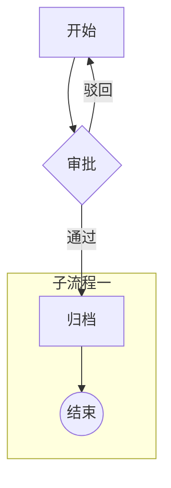

# mmagix-files 流程图应用设计（Mermaid 源 + X6 编辑）

> **【实施状态注记 · 2026-10-26 审计】** MVP-①②③④ 已实现且核心契约吻合；以下以代码为准：
> 1. **未实现**：BPMN 导出（§五/MVP-⑤ 全章）、SVG 旁路键（`<key>.svg.derived/`）
> 2. **口径演进**：布局缓存旁路键 → `%% meta: _layout` 伪节点（随源持久化）；graph LR 可进编辑器（布局强制 TD，保存保留 LR 头行）；subgraph 仅行透传不建组；meta 重复静默覆盖（不告警）
> 3. **X6 v2 适配（代码已踩平，本文按 v1 撰写）**：DEF-1 zoom 增量陷阱（读-算-写绝对值）、DEF-2 mousewheel 配置失效（ctrl+滚轮手工监听）、DEF-3 无 toSVG（画布 SVG 序列化导出）、DEF-6 removeCell 级联删边（applyNodeCell 补回相邻边）——见 `flow-editor.ts` 文件头
> 4. **【2026-10-31 更新】四方言终态**：§六脑图「不进本期」已过时——mindmap/sequenceDiagram/architecture-beta 均已随 v1.2.0 进 X6 可视化编辑（实现口径与终态见 [diagram-roadmap.md](diagram-roadmap.md) 头注与 `files/flow-model.ts` parseMindmap/parseSequence/parseArchitecture）；候选库 simple-mind-map/mind-elixir 均未引入（统一用 X6）；MVP-②/验收所提 `apps-demo/diagrams/*.mmd` seed 未落仓（E2E 用内联 fixture，`e2e/fixtures/s3-mock.ts`）


## 〇、头表

| 项 | 值 |
| --- | --- |
| 版本 | V1.0（2026-10-13 首版） |
| 状态 | **草案（候裁）** |
| 依据 | 《solution-design.md》应用模型；《style-isolation.md》V1.0（同文档+约定式隔离结论）；本设计前置于 2026-10-13 会话评估结论 |
| 范围 | 流程图（graph TD 子集）的存储格式 / 渲染 / 可视化编辑 / BPMN 交换导出；脑图（mindmap）沿用同一架构，本文附带口径 |
| 定位 | 新内置应用（`mermaid-viewer` 只读兜底 + `flow-editor` 编辑），走既有 AppRegistry/「打开方式」体系，不改 JSSDK 协议 |

---

## 一、背景与设计原则

### 1.1 为什么是 Mermaid 作源格式

- **AI 理解优先**：LLM 对 mermaid 的生成/理解是各图格式中训练语料最充分的；每节点 token 密度 ~3–5，无坐标噪声
- **纯文本**：S3 对象即文本 → git 友好、code-editor 可直接编辑、天然进 RAG/AI 管线
- **渲染生态现成**：mermaid.js 前端现渲 SVG，兜底零成本

### 1.2 三条设计原则（纪律性条款）

1. **子集契约**：编辑器只声明支持 mermaid 的一个明确子集；**子集外的语法行原样透传**（无损保留），解析失败不静默丢弃
2. **无损透传**：X6 编辑器只改写它认识的行；用户手写的 `classDef`/`style`/注释等一律原样保留
3. **双渲染不追求像素一致**：X6（编辑态）与 mermaid.js（兜底只读态）是两个引擎——兜底定义为「降级可用」，不做 CSS 层对齐

---

## 二、总体架构

```
.mmd 文件（S3 对象，纯文本）
   graph TD 正文  +  %% meta 注释块          ← 唯一源头（source of truth）
   │
   ├─① 解析层：mermaid AST（子集）+ meta 提取（转义对称）
   │
   ├─② mermaid.js 直渲 SVG ───────────────── 兜底渲染（只读；无 X6 时/移动端/降级）
   │      └─ SVG/PNG 导出 → 通用预览交换（现有 image-viewer 可消费）
   ├─③ dagre 自动布局 → AntV X6 ──────────── 编辑渲染（拖拽/属性面板/形状调色板）
   │      └─ 回写 .mmd（行级 patch + 透传 + meta 块重建）
   └─④ BPMN 导出（语义 + DI 坐标）────────── 交换（有限子集，单向流出）
          bpmn-moddle 序列化；DI 坐标取 X6/dagre，或 bpmn-auto-layout 生成
```

---

## 三、数据格式规范

### 3.1 源格式 = 「mermaid graph TD 子集 + meta 注释」超集



### 3.2 语法子集契约（V1）

| 语法 | 支持 | 说明 |
| --- | --- | --- |
| `graph TD`（上下流向） | ✅ | 仅 TD；LR 作为只读透传（编辑器不产出） |
| 节点形状 | ✅ 方 `[ ]` / 菱 `{ }` / 圆 `(( ))` / 圆角 `( )` | 与 X6 调色板一一映射（§四.3） |
| 边 | ✅ `-->` / `-->|label|` | 带标签边 |
| subgraph | ✅ 单层 | 嵌套 subgraph 只读透传（编辑器不产出） |
| `classDef` / `style` / `linkStyle` | ⚠️ 只读透传 | 解析保留原文，编辑器不产出不修改 |
| 节点 id | ✅ `[A-Za-z0-9_]+` | 超出范围只读透传 |
| 其余一切语法（class 图/时序图等） | ⚠️ 非本应用：文件级路由 | 解析失败 → 交给 `mermaid-viewer` 兜底或下载 |

### 3.3 `%% meta:` 注释规范

- 形态：`%% meta: <nodeId|schema> <JSON 单行>`
- 首行固定 `%% meta: schema=v1`（schema 演进靠版本字段）
- 每个 nodeId 至多一条 meta；重复取最后一条并告警
- **转义对称**：label 含 `"`/`|`/换行 时，解析与序列化必须使用同一套转义规则（mermaid 引号包裹 `A["文本(带括号)"]`），回写走同一函数对
- meta 是**渲染无关数据**（负责人/SLA/风控/外部链接），渲染器一律不展示；AI 与 BPMN 导出消费

### 3.4 与 AI 管线的契约

- 文件即上下文：`.mmd` 直接进 prompt（正文+meta 对 LLM 均为语义）
- 生成侧约束提示词模板要求：仅产出 §3.2 子集语法 + meta 规范形态
- 解析器对 LLM 输出宽容：容忍多余空白/引号风格差异，失败进兜底渲染

---

## 四、渲染链路

### 4.1 兜底：mermaid.js（只读）

- 动态 import（与 pdfjs/xlsx 同口径，不入主 bundle）
- 直接渲染源文本（**含未知语法**——兜底态天然比编辑态支持面宽）
- SVG 导出：`mermaid.render` 产物落 S3 旁路键（`<key>.svg.derived/`），供缩略图与 `image-viewer` 复用

### 4.2 编辑：dagre + AntV X6

- **布局**：X6 无自动布局，配 `dagre`（mermaid 内部同款引擎，观感一致性最好）；X6 打开时优先读布局缓存旁路键，无缓存则 dagre 现算
- **调色板收敛**（形状双向映射表，调色板比语法先收敛）：

| mermaid | X6 形状 |
| --- | --- |
| `A[label]` | rect |
| `A{label}` | polygon（菱形） |
| `A((label))` | ellipse |
| `A(label)` | round-rect |
| `subgraph` | X6 group/组合节点（单层） |

- **属性面板**：label / 形状（映射表内切换）/ meta JSON 表单化（schema=v1 字段集）
- 编辑态与兜底态不追求像素一致（原则 1.2.3）

### 4.3 回写（X6 → .mmd）

- **行级 patch 策略**：解析时记录每条语句的行号区间；编辑只重写被改语句的行，未涉及行（透传行/注释/未知语法）原样保留
- meta 变更 → 重建 `%% meta` 块（整个 meta 块物理上集中在文件头部，重建不影响正文行）
- 保存链：复用工作台既有 putObject 链（Ctrl+S / 关闭确认 / 只读闩锁，与 code-editor 同口径）

---

## 五、BPMN 导出（单向、有限子集）

### 5.1 映射表

| 源（.mmd） | BPMN 语义 | DI 坐标 |
| --- | --- | --- |
| `A[任务]` | `task`/`userTask`（meta.kind 可细分） | X6/dagre bounds |
| `A{条件}` | `exclusiveGateway` | 同上 |
| `A(( ))` 首末节点 | `startEvent` / `endEvent` | 同上 |
| `-->` / `-->|label|` | `sequenceFlow`（+ `conditionExpression`） | waypoint 取 dagre 边拐点，或 `bpmn-auto-layout` 整体重排 |
| `subgraph` | 子流程容器（单层） | 同上 |
| meta 注释 | 不进 BPMN（无标准承载）；可选 `documentation` 字段 | — |

### 5.2 实现与损失清单

- 实现：`bpmn-moddle` 构建 + 序列化；DI 二选一（自带坐标直写 / 导出纯语义后跑 `bpmn-auto-layout` 生成）——**首版选后者**（少一套坐标折算，bpmn-io 官方包）
- **损失清单（对外承诺口径）**：无泳道、无边界/定时/消息事件、无双层子流程、无样式色彩——导出物是「干净的语义 BPMN」，可在 Camunda/ bpmn.io 打开继续编辑
- 单向流出：不做 BPMN→mermaid 导入（候裁项，见 §八）

---

## 六、与现有应用体系的集成

| 项 | 口径 |
| --- | --- |
| 注册表新增 | `mermaid-viewer`（ext: mmd/mermaid，view；渲染=mermaid.js）与 `flow-editor`（同扩展名，edit；渲染/编辑=X6）——注册序：editor 先（默认应用），viewer 经「打开方式」可达（对齐 csv-table/code-editor 先例） |
| 隔离 | 同文档+约定式：渲染器类名 `mmagic-*` 前缀；样式随实例注入随 dispose 移除（对齐 pdf.ts 口径） |
| 字节限额 | mermaid 文本极小，沿用 code-editor 口径 5MB（`MERMAID_MAX_BYTES`，进 BUILTIN_APP_SPECS） |
| i18n | 全部文案走词典 `app.*`；禁硬编码中文 |
| 保存链 | 复用 code-editor 契约：Ctrl+S / `app.code-unsaved` 关闭确认 / putObject 拒 4305 只读闩锁 |
| 脑图（附带口径） | `mindmap` 语法纳入 `mermaid-viewer` 只读支持；X6 脑图编辑**已随 v1.2.0 落地**（不引入 simple-mind-map/mind-elixir，统一 X6；终态见头部注记 4 与 diagram-roadmap.md） |

---

## 七、分期与验收

| 期 | 交付 | 验收标准 |
| --- | --- | --- |
| MVP-① | 解析器 + meta 提取 + 转义对称 | 单测：子集语法/透传/转义往返全绿 |
| MVP-② | `mermaid-viewer`（mermaid.js 渲染 + SVG 导出） | seed 新增 `apps-demo/diagrams/approval.mmd`；双击出图；SVG 旁路键可被 image-viewer 打开 |
| MVP-③ | dagre+X6 渲染（编辑态打开） | 与兜底态节点/边拓扑一致 |
| MVP-④ | X6 回写（行级 patch + meta 重建） | 往返测试：原文件→X6 打开→不改→保存，diff 为空；改一处→仅目标行变化 |
| MVP-⑤ | BPMN 导出 | 导出物在 bpmn.io 可开、拓扑一致；损失清单明示 |

> MVP-② 即可上线「AI 生成 → 人可看」闭环；④ 起才涉及 X6 编辑面。

---

## 八、开放问题（候裁）

1. BPMN→mermaid 导入是否立项（有 LLM 直转的廉价路线，建议按需）
2. 脑图 X6/simple-mind-map 编辑是否随 flow-editor 顺带立项
3. 布局缓存旁路键的生命周期（对象删除/重命名时的派生键清理，与 SVG 导出同问题，归入「派生对象」通用机制）
4. `graph LR` 编辑态支持是否放开（只读透传已定）

## 九、参考

- Mermaid 官方文档（flowchart/mindmap/frontmatter）：https://mermaid.js.org
- AntV X6：https://x6.antv.antgroup.com ；dagre：https://github.com/dagrejs/dagre
- bpmn-moddle：https://github.com/bpmn-io/bpmn-moddle ；bpmn-auto-layout：https://github.com/bpmn-io/bpmn-auto-layout
- Mermaid Chart（官方商业可视化编辑器，形态参照）：https://mermaidchart.com
- 本仓：《../product/PRD.md》应用清单 / 《style-isolation.md》隔离结论 / 《plugin-system.md》T2 沙箱口径
