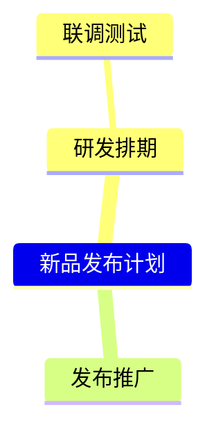

# 脑图重写方案（mind-editor）——对标 XMind/MindManager/MindMaster

> **【实现状态 · 三期全部收口（2026-11-11 终刷）】** 本篇为重写方案正本，2026-11-10 立。原型已出（[prototypes/index.html](prototypes/index.html)，真引擎渲染六视图）；**P0（MC0–MC4）/P1（MC3 编辑面对齐+MP1 多布局/主题切换 UI）/P2（MP2：导出 png·svg·json·OPML、`.xmind` 导入、模板库三套、主题样式面板 custom 持久化、快赢池排空）三期全部落地收口**；测试终态=mindEditor.test.ts 129 例+mind 面 100 例。实现账正本=[.claude/mind-loop-state.md](../../../.claude/mind-loop-state.md)（里程碑/契约/评审逐笔）；**embed-demo parity=记账请裁**（embed-demo 工作树被另一工作线 site2 占用，建议 site2 落地后单独立批）；§九 文档联动清单已随 MD-P1 批次落地，文档面终刷随 MD 尾批完成。

## 〇、头表

| 项 | 值 |
| --- | --- |
| 版本 | V1.0（2026-11-10 首版） |
| 状态 | **P0/P1/P2 三期全部落地收口（P0/P1=2026-11-10、P2=2026-11-11）；embed parity 请裁（实现账：`.claude/mind-loop-state.md`）** |
| 对标 | 知名脑图软件 TOP3（XMind / MindManager / MindMaster）的外观与编辑功能，以 XMind 为主基准 |
| 依据 | 《flow-editor-design.md》（meta 通道与 raw 优先纪律的正本）、《diagram-roadmap.md》（四方言现状正本）、2026-11-10 对话裁决 |
| 范围 | 脑图编辑器整体重写：引擎、外观、交互、meta 持久化扩展、应用拆分；流程图/时序图/架构图三方言不动 |
| 定位 | 图示家族从「通用图编辑器画树」升格为「真脑图软件」；存储契约（mermaid 文本真源）不变，AI 语料链不中断 |

## 一、总体结论（先读这节）

| 项 | 定案 |
| --- | --- |
| 主存 | **mermaid `mindmap` 文本不动**（D1）；视图态与超集数据走 **`%% meta:` 注释通道**（D2，流程图已验证的既有基建） |
| 引擎 | **simple-mind-map@0.14.x（MIT）**替换脑图方言的 X6 编辑面（D3/D-LICENSE）；包内插件源码全部可用（MIT）按里程碑分批启用，红线只剩「不引入包外付费/闭源件」 |
| 外观 | 自带 **XMind 风主题包**（`defineTheme` 自定义，npm 包仅内置 default）+ 有机曲线枝 + 无框叶子（原型 p1–p5 已验证可达） |
| 编辑 | XMind 键位模型：Enter/Tab/Insert/拖拽重挂/双击改文案/折叠/撤销重做/多选/子树复制粘贴（§六映射表） |
| 身份键 | mindmap 语法无节点 id，meta 键 = **文本+路径合成，best-effort 匹配**；同工具往返零丢失，外部改树降级丢装饰不丢树（D4） |
| 门控 | **能力门控解除**——meta 通道使超集能力可持久化，概要/关联线/备注等入口全部可见可用（D5） |
| 应用形态 | 拆独立 **`mind-editor`** 应用；flow-editor 退回 flowchart/sequence/architecture 三方言；mermaid-viewer 不动（D6/D7） |
| 兼容 | 旧 `.mmd` mindmap 文件零迁移；mermaid 语法不变，viewer/AI 链零破坏 |

## 二、现状与差距

现状（diagram-roadmap.md 终态）：脑图 = mermaid `mindmap` 文本 + mermaid.js 只读查看 + flow-editor 的 X6 画布编辑（缩进树 parse/serialize、添加分支挂选中节点）。本质是「流程图编辑器里画树」，差距：

| XMind 级能力 | 现状 | 重写后 |
| --- | --- | --- |
| 有机曲线枝、主题皮肤、无框叶子 | ✗ 直线边+矩形卡片 | ✓ 引擎主题包（原型已验证） |
| 多布局（逻辑/导图/组织/鱼骨/时间轴） | ✗ 右展开 | ✓ 引擎七布局，布局=视图态进 meta |
| 概要 / 关联线 | ✗ | ✓ 引擎原语（generalization/associative 已在主题 schema 证实）+ meta 持久化 |
| 外框（boundary） | ✗ | ✓ 引擎专用原语——OuterFrame 插件（P1 分批启用；【勘误 2026-11-10 实现勘察】原「模拟或砍」评估作废，见 §八 R6） |
| 备注 / 图片 / 标签 / 超链接 | ✗ | ✓ 引擎节点字段 + meta 持久化（图片仅 URL） |
| Enter/Tab 键位、拖拽重挂、折叠 | ✗ 两击连线式 | ✓ 引擎自带 |
| 大纲视图、多选、子树复制粘贴 | ✗ | ✓ P1 |
| 主题层级样式（root/second/node/third） | ✗ 无主题体系 | △ third 键不被引擎消费——引擎按 layerIndex 只读 root/second/node（Style.js merge，≥2 层取 node），叶子视觉=引擎 default 兜底；正本 third 块保留=忠实抄写（D-THEME），见 §五 勘误注记 |

## 三、裁决记录（本次对话逐条）

- **D1 主存不动**：mermaid `mindmap` 文本仍是唯一结构真源。理由：AI 语料链（AI 读改零失真）是图示家族的架构地基；viewer/回写/raw 优先纪律全部压在这上面。JSON/.xmind 主存路线否决（换存=全家链路重构，收益不抵）。
- **D2 meta 通道扩展**：`%% meta:` 注释通道（`META_RE`/`metaById`/meta 块整体重建，flow-model.ts 已有）为全家族共享基建；脑图沿用同一契约持久「视图态 + 超集数据」。与流程图 `_layout` 伪节点完全同构。
- **D3 引擎选型**：simple-mind-map@0.14.x。对比：mind-elixir（MIT）外观好但仅左右布局、无概要/关联线——只够仿外观不够仿功能；自研周期不成比例。**红线**：npm 包核心 MIT 免费；官方付费 Pro 插件（协同、导出 PDF、导出 .xmind 等）**禁用**，依赖审查闸盯 `import 面` 只落 core+白名单免费插件。
  > **【勘误 2026-11-10 实现勘察 → D-LICENSE】** 原红线口径失实：npm 包 license=**MIT** 且**全部插件源码在包内**（`node_modules/simple-mind-map/src/plugins/` 清单实证，0.14.0-fix.3：Drag/Select/AssociativeLine/KeyboardNavigation/MiniMap/Search/Export/ExportPDF/ExportXMind/OuterFrame/RainbowLines/RichText/NodeImgAdjust/Demonstrate/TouchEvent/Watermark/Scrollbar/Formula/FormulaStyle/Painter/Cooperate/MindMapLayoutPro 等）。「官方付费 Pro 插件禁用 + 白名单」作废——**包内源码全部可用（MIT），红线只剩「不引入包外付费/闭源件」**；白名单限制取消，改**按里程碑分批启用**（usePlugin 分批账见状态文件 `.claude/mind-loop-state.md`「引擎能力实证与裁决」节）。
- **D4 身份键口径**：mermaid mindmap 语法无节点 id（文本即 id），meta 键 = `文本 + 兄弟序路径` 合成。载入时 best-effort 匹配：键全对→零丢失；树被外部改过→对不上的装饰**降级丢弃、树无损**，保存时按当前树重写键。对齐既有「meta 行 JSON 非法按 raw 透传+接受丢失」MVP 口径。**同编辑器往返（99% 场景）零丢失**——每次保存重写键，自己读自己永远对得上。
- **D5 门控解除**：早前「超集能力入口隐藏」的预案作废——meta 通道使其可持久化，全部入口可见可用。
- **D6 应用拆分**：脑图方言从 flow-editor 移交独立 `mind-editor` 应用（当年「不新增独立应用」的前提已被重写推翻）；flow-editor 保留 flowchart/sequence/architecture 三方言。registry 同 ext（mmd/mermaid）双编辑应用冲突的解决：**方言路由**——按首行语法嗅探分派（`mindmap`→mind-editor，其余→flow-editor），registry 层小改，见 §八 R4。
  > **【勘误 2026-11-10 实现勘察 → D6'】** `registry.resolveDefault(fileRef)` 仅持元数据（name/mime/size）无内容，registry 层内容嗅探须重排 preview 打开链（重改，否决）。落地改为**渲染器内分派**：应用条目保持 flow-editor 不变，渲染入口 `detectDialect(text)==='mindmap'` → **动态 import** MindEditor 渲染面（`apps/renderers/mindEditor.ts`，动态导入同时隔离既有 flow-editor jsdom 测试面并分割引擎 chunk），X6 面只服务其余三方言；registry/打开方式菜单/preview 链零改动。R4 随之消解。
- **D7 查看面不动**：只读查看仍走 mermaid-viewer；meta 注释行 mermaid 渲染器天然忽略，viewer 零改动。

## 四、meta 通道扩展契约

| 通道 | 载荷 | 说明 |
| --- | --- | --- |
| `%% meta: schema=v1` | 版本行 | 沿用流程图口径 |
| `%% meta: _mindview {…}` | `{layout, theme}` | 视图态伪节点（对应流程图 `_layout`）。布局/主题本质是视图属性，存它零数据风险 |
| `%% meta: _assoc {…}` | 关联线数组 | 跨节点数据不挂单节点，走伪节点 |
| `%% meta: <文本+路径键> {…}` | `{note, image, hyperlink, tags, generalization(概要), style}` | 每节点超集数据 |

纪律（全部沿用 flow-editor-design.md §三，零新造）：
- meta 块 header 后整体重建、旧 meta 行跳过、**raw 优先**（未编辑行零 diff，AI 读树不受注释噪声影响）
- 非法 JSON：raw 透传 + 告警 + 接受丢失（MVP 口径）
- **单行护栏**：meta 行必须单行 JSON（`JSON.stringify` 天然满足）；单行长度上限 8KB 超限拒收+告警；**图片只收 URL 不收 base64**（data URL 超限即毁图，直接禁入）

## 五、引擎集成与主题包

- 引擎装载：simple-mind-map UMD/ESM 进前端依赖（工作区 pnpm，版本钉 0.14.x minor）；脑图方言渲染面在 `apps/renderers/mindEditor.ts`（与 flow-editor.ts 平级，复用 datasource/保存链/隔离口径）。
- **主题包自带**：npm 包仅内置 default（已实测）；`MindMap.defineTheme('xm-*', …)` 注册我们自己的 XMind 风主题（青绿/雾蓝/石墨/琥珀四套起步，原型即真渲染）。主题名写进 `_mindview.theme` 持久化。
  > **【勘误 2026-11-10 实现勘察 → 主题层级样式（D-THEME）】** 引擎 0.14.0-fix.3 节点样式按 `layerIndex` 读 **root/second/node**（`src/core/render/node/Style.js` `merge()` L76 起：0→root、1→second、≥2→node），主题包的 **`third` 键不被引擎消费**。主题包正本（原型 proto-common.js XM_THEMES）的 third 块保留 = **忠实抄写义务**，叶子视觉由引擎 default（`src/theme/default.js`）兜底 = 用户确认的原型实况（裁决 **D-THEME**：不新增 node 覆盖块，键迁移无收益）。另：`second.fontWeight` 终态 = **normal**（引擎 default L123 原值；轮 1 评审 P1-1 修正 themes.ts 曾误抄的 bold 漂移，测试已钉）。
- 布局：`logicalStructure`（缺省）/`mindMap`/`organizationStructure`/`fishbone`/`timeline`/`verticalTimeline`/`catalogOrganization`——布局选择进 `_mindview.layout`。
- 视图偏好与文件冲突时**以文件为准**（meta 是真源）；无 meta 的旧文件用引擎缺省。
- 样式隔离：引擎 SVG+内联样式为主，风险低；编辑器容器 scoped reset（`p{margin:0}` 等，原型踩过：UA 缺省 margin 会把 foreignObject 文本推出裁切）；按 style-isolation.md 口径验证。

## 六、交互与键位映射（对标 XMind）

| 操作 | 键位/手势 | 来源 |
| --- | --- | --- |
| 加兄弟（下/上） | `Enter` / `Shift+Enter` | 引擎+自接 |
| 加子级 | `Tab` / `Insert` | 引擎+自接 |
| 改文案 | 双击 / `F2` | 引擎自带 |
| 删节点 | `Delete` | 引擎自带 |
| 重挂父 | 拖拽（挂载指示：子/前/后） | 引擎 Drag 插件 |
| 折叠/展开 | 节点按钮 / 空格 | 引擎 |
| 撤销重做 | `Ctrl/Cmd+Z` / `Shift+Z` | 引擎 |
| 多选 | `Shift/ Cmd+点选`、框选 | 引擎 Select 插件 |
| 子树复制粘贴 | `Ctrl+C/V`（缩进文本互通，粘贴自动成树） | 引擎+自接 |
| 搜索定位 | `Ctrl+F` | P1 |
| 缩放平移 | 滚轮/拖画布/`Ctrl+滚轮` | 引擎自带 |

  > **【勘误 2026-11-10 实现勘察 → 键位映射表】** 上表三行与引擎 0.14.0-fix.3 实测不符（Command.js/Render.js/TextEdit.js/MindMapNode.js 实锚）：「`Shift+Enter` 加兄弟（上）」**无绑定**——实锚 `Shift+Tab`=加父级（INSERT_PARENT_NODE）、`Enter`=加兄弟；「空格折叠」**无绑定**——实锚 `` `/` `` 键=折叠/展开切换（toggleActiveExpand）；「`Shift+Z` 重做」**无绑定**——实锚 `Ctrl+Y`=重做（FORWARD，Command.js 仅注册 Control+z/y）。另多选实锚=**`Ctrl/⌘`+点选加选**（enableCtrlKeyNodeSelection）+**`Ctrl/⌘+A` 全选**+Select 插件框选（无 Shift+点选）。三键位如需对标 XMind 全集须自接线，归 P2 提案；用户手册脑图章与 CHANGELOG 已按实锚口径书写。

插件清单（免费面，实现期按版本复核）：Drag、Select、AssociativeLine（关联线）、KeyboardNavigation、MiniMap、Export（png/svg/json）、ExportPDF/ExportXMind、Search（定位）、OuterFrame（外框）、RichText（如需，quill 依赖另评）、TouchEvent（移动端）——全部包内源码可用（MIT），按里程碑分批启用（usePlugin 分批账见状态文件）。
  > **【勘误 2026-11-10 实现勘察 → 白名单取消】** 原文「插件白名单（免费面，实现期按版本复核）：Drag、Select、AssociativeLine…Export（png/svg/json——**ExportPDF/ExportXMind 等 Pro 件不在白名单**）、RichText…、TouchEvent」作废：npm 包 license=MIT 且全部插件源码在包内（`src/plugins/` 实证，见 §三 D3 勘误 D-LICENSE），白名单限制取消、改按里程碑分批启用；红线只剩「不引入包外付费/闭源件」。

## 七、分期

- **P0 骨架可换血**：mind-editor 应用注册+方言路由；引擎集成+四主题包；mermaid 双向转换（树+形状+icon 往返，复用 parseMindmap/serializeMindmap 契约）；保存链打通（S3/WebDAV/mem 零改动）；Enter/Tab/双击/拖拽重挂/折叠/撤销/缩放平移；`_mindview` 持久布局与主题。——**此批落地即「看起来就是脑图软件」**；**✅ 已落地（2026-11-10 收口）**
- **P1 编辑面对齐**：概要/关联线/备注/标签/超链接/图片(URL)+meta 持久化；多选与子树复制粘贴；大纲视图切换；搜索定位；外框=OuterFrame 插件直接启用（R6 勘误后定案，已落地）。——**✅ 已落地（2026-11-10 收口，含 MP1 多布局/主题切换 UI）**
- **P2 生态**：主题样式面板（自定义色/线型）；导出 png/svg/OPML；`.xmind` 导入（zip+content.json，逃生舱；仓内 zip 经验可复用）；模板库；embed-demo 官网演示 parity 同步。——**✅ 已落地（2026-11-11 收口；导出实为 png/svg/json/OPML 四格式；embed-demo parity 请裁——工作树由 site2 工作线占用，建议其落地后单独立批）**

## 八、风险与实现期裁决点

- **R1 身份漂移**（D4 已裁）：外部改树后装饰降级丢失——可接受口径，告警不阻塞。
- **R2 依赖红线（D-LICENSE 勘误后口径）**：红线只剩「不引入包外付费/闭源件」——依赖审查盯 import 面不引入包外件；`pnpm why`+包内容复查入五闸外清单。
- **R3 测试环境文本测量**：jsdom 无 SVG/foreignObject 真实测量——**转换层全部纯函数化**（tree↔mermaid↔引擎数据三向转换、meta 读写、身份键匹配/降级），单测打纯函数；组件测试只测壳与装配，不测引擎内部。
- **R4 registry 方言冲突**（D6）：同 ext 双编辑应用的分派——首行嗅探 `mindmap`（已有方言分派同款逻辑下沉 registry）。实现期第一坑，先写契约用例。
- **R5 双应用并存口径**：旧文件只有 mindmap 方言→进 mind-editor；四方言混合文件不存在（mindmap 单方言文件），无迁移面。
- **R6 外框**：P1 = OuterFrame 插件直接启用（usePlugin 分批账：MC3 批次随关联线/搜索同批）。
  > **【勘误 2026-11-10 实现勘察 → R6】** 原文「**R6 外框无引擎原语**：P1 评估——a) 逐分支 fillColor 矩形模拟 b) 概要功能代偿 c) 砍。默认 c，若用户强需求再 a」作废：`src/plugins/OuterFrame.js` + `src/plugins/outerFrame/` 插件目录实证存在（0.14.0-fix.3 包内），引擎有专用外框原语，「模拟或砍」三选一评估作废，直接用插件。
- **R7 headless 截图伪影**：foreignObject 文本在无头截图可能花字（已实测）——e2e 断言走 DOM 不走像素；像素验收人工过原型。

## 九、流程与文档联动

按仓惯例：测试先行（R3 纯函数面）、子代理分工（业务/测试分代理）、每批 ≤1000 行、五闸（vue-tsc/vitest/lint/files-client 哨兵/build）+ Playwright e2e。

实现启动时的文档联动账：diagram-roadmap.md 头注翻转（mindmap 方言移交 mind-editor）；flow-editor-design.md 注记方言拆分；architecture.md 目录职责；user-guide 脑图章重写；CHANGELOG；PRD 追加 FR；docs/README.md 索引行状态刷新。demo（mmagix-embed-demo）parity 在 P2。

## 十、原型证据

[prototypes/index.html](prototypes/index.html)——真引擎（simple-mind-map@0.14.0-fix.3 UMD via CDN）渲染同一棵示例树 × 六视图，png/ 下有 2880×1800 实拍：

| # | 视图 | 布局 | 主题 |
| --- | --- | --- | --- |
| p0 | 交互基线 | logicalStructure | default |
| p1 | XMind 主视图同款 | logicalStructure | xm-green（自定义） |
| p2 | 左右分布 | mindMap | xm-blue（自定义） |
| p3 | 组织结构 | organizationStructure | xm-slate（自定义） |
| p4 | 鱼骨图 | fishbone | xm-green（自定义） |
| p5 | 时间轴 | timeline | xm-amber（自定义） |

原型期实测勘误（实现期直接受益）：`mm.fit()` 不存在，正确入口 `mm.view.fit()` 且须挂 `node_tree_render_end` 后调；npm 包仅 default 主题、其余须 `defineTheme` 自注册；UA 缺省 `p margin` 会把 foreignObject 文本推出节点框（容器必须 reset）；无头截图 foreignObject 可能有花字伪影（DOM 本身正常，R7）。
